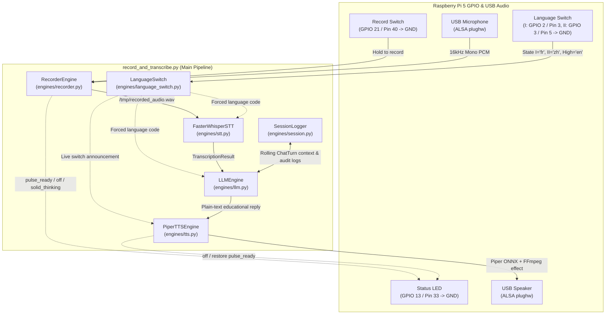

# Raspberry Pi 5 Educational Voice Assistant — Architecture Overview

This project is an interactive, child-friendly multilingual voice assistant running on a **Raspberry Pi 5**. It captures speech while a physical push/toggle switch (or keyboard key) is held, transcribes the audio locally using **Faster-Whisper (CTranslate2 INT8)**, queries an educational **LLM (Google Gemini / OpenAI / Ollama)** with rolling conversation memory, synthesizes the answer locally using **Piper neural TTS** (with optional goofy FFmpeg voice effects), and logs full session transcripts for parental auditing.

---

## 1. High-Level Pipeline & Hardware Flow



---

## 2. Raspberry Pi 5 GPIO & Hardware Pinout

| Component | BCM GPIO | Physical Pin | Wiring & Active State | Behavior |
| :--- | :--- | :--- | :--- | :--- |
| **Record Switch** | `GPIO 21` | Pin 40 ($\rightarrow$ GND Pin 39) | Active `LOW` (internal pull-up) | Closed = recording audio; Open = stop & process |
| **Language Switch — State I** | `GPIO 2` | Pin 3 ($\rightarrow$ GND Pin 6/9) | Active `LOW` (1.8 k$\Omega$ onboard pull-up) | Closed = force **French (`fr`)** |
| **Language Switch — State II** | `GPIO 3` | Pin 5 ($\rightarrow$ GND Pin 6/9) | Active `LOW` (1.8 k$\Omega$ onboard pull-up) | Closed = force **Chinese (`zh`)** |
| **Language Switch — Center/Open** | `GPIO 2 & 3` | Pins 3 & 5 both `HIGH` | Both pins `HIGH` (3.3V pull-up) | Forces **English (`en`)** |
| **Status LED** | `GPIO 13` | Pin 33 ($\rightarrow$ GND Pin 34) | Active `HIGH` (PWM output) | **Pulsing** = ready; **Off** = recording/speaking; **Solid ON** = thinking |

---

## 3. Repository Layout

```text
rpi_voice/
├── record_and_transcribe.py        # CLI entrypoint & main interaction loop (run_pipeline)
├── ARCHITECTURE.md                 # Module and hardware architecture documentation
├── engines/                        # Core modular engine package
│   ├── __init__.py                 # Public package exports
│   ├── config.py                   # Central constants, GPIO pins, prompts, voices, effects
│   ├── audio_devices.py            # Dynamic USB microphone & speaker ALSA discovery
│   ├── led.py                      # PWM GPIO status LED state controller
│   ├── language_switch.py          # Background GPIO 2/3 language selector & voice announcer
│   ├── recorder.py                 # Push-to-talk ALSA recorders (GPIO switch & keyboard)
│   ├── stt.py                      # FFmpeg audio preprocessing + Faster-Whisper STT engine
│   ├── llm.py                      # Educational LLM engines (Gemini, OpenAI, Ollama, Echo)
│   ├── tts.py                      # Piper ONNX neural TTS + FFmpeg goofy voice filters
│   └── session.py                  # Rolling conversation memory & session audit logging
├── voices/                         # Local Piper ONNX voice models (.onnx & .onnx.json)
└── sessions/                       # Per-session parental audit logs (session_<timestamp>/)
```

---

## 4. Module-by-Module Reference

### 4.1 Entrypoint: `record_and_transcribe.py`
The top-level orchestrator and CLI parser:
- **`main()`**: Parses CLI flags (GPIO pins, STT model, LLM provider/model, context window settings, TTS voice speed and goofy effect), detects USB audio hardware, initializes engines, preloads TTS models into RAM, starts background language-switch monitoring, and ensures clean GPIO/session teardown on `SIGINT`/`SIGTERM`.
- **`run_pipeline()`**: Runs the main `Record -> Transcribe -> LLM -> Speak` loop:
  1. Waits for `recorder.record()` to capture `/tmp/recorded_audio.wav`.
  2. Sets `status_led.solid_thinking()`.
  3. Queries `language_switch.current_language` (or CLI `--language`) and calls `stt_engine.transcribe()`.
  4. Retrieves active conversation context from `session_logger.get_context_for_next_turn()`.
  5. Queries `llm_engine.generate()` for a child-friendly educational explanation in the active language.
  6. Logs the turn to disk via `session_logger.log_turn()`.
  7. Synthesizes and plays the response via `tts_engine.speak()`.

---

### 4.2 Central Configuration: `engines/config.py`
Single source of truth for all defaults and mappings:
- **GPIO Defaults**: `DEFAULT_GPIO_PIN` (`21`), `DEFAULT_LED_GPIO_PIN` (`13`), `DEFAULT_LANG_SWITCH_PIN_1` (`2`), `DEFAULT_LANG_SWITCH_PIN_2` (`3`), debounce/settle timings.
- **Audio & STT Settings**: 16 kHz sample rate (`RATE`), Silero VAD thresholds (`DEFAULT_VAD_PARAMETERS`), FFmpeg bandpass + dynamic normalization filter (`STT_AUDIO_FILTER`), and `DEFAULT_STT_MODEL` (`"base"`).
- **Language & Voice Mappings**:
  - `LANGUAGE_NAMES`: ISO code $\rightarrow$ human-readable language name.
  - `LANGUAGE_SWITCH_ANNOUNCEMENTS`: Native spoken confirmations when flipping the switch (`"en"`, `"fr"`, `"zh"`).
  - `PIPER_VOICE_MAP` & `AVAILABLE_PIPER_VOICES`: Maps `"en"` (`en_GB-semaine-medium`), `"fr"` (`fr_FR-upmc-medium`), `"zh"` (`zh_CN-huayan-medium`, `zh_CN-xiao_ya-medium`, `zh_CN-chaowen-medium`), and 15+ other languages to Piper ONNX models.
  - `VOICE_EFFECTS`: FFmpeg filter graphs for `"none"`, `"chipmunk"`, `"helium"`, `"monster"`, `"robot"`, `"alien"`, and `"wobble"`.
- **LLM & Guardrails**: `DEFAULT_SYSTEM_PROMPT` enforcing factual, age-appropriate (3–5 years old), 1–3 sentence plain-text answers with no roleplay or markdown.

---

### 4.3 USB Audio Discovery: `engines/audio_devices.py`
Automatically finds attached USB audio peripherals by parsing `arecord -l` and `aplay -l` so USB port/card renumbering across reboots never breaks audio I/O:
- **`detect_usb_mic_device()`**: Returns `plughw:CARD=<usb_card_name>,DEV=0` (fallback `plughw:CARD=Device,DEV=0`).
- **`detect_usb_speaker_device()`**: Returns `plughw:CARD=<usb_card_name>,DEV=0` (fallback `default`).

---

### 4.4 Status LED Controller: `engines/led.py`
- **`StatusLED`**: Wraps `gpiozero.PWMLED` on BCM GPIO 13 and tracks the logical state (`"ready"`, `"thinking"`, `"off"`):
  - `pulse_ready()`: Smooth background fade-in/fade-out while waiting for user input.
  - `off()`: Turns LED off during active voice recording or speaker playback.
  - `solid_thinking()`: Solid ON while STT, LLM, and TTS synthesis are running.
  - `close()`: Drives the pin to `0V`, configures a pull-down via `lgpio`, and releases the line so the LED never glows dimly after exit.

---

### 4.5 Live Language Switch: `engines/language_switch.py`
- **`LanguageSwitch`**: Monitors the 3-state physical switch on BCM GPIO 2 and GPIO 3 in a background daemon thread:
  - `read_language()`: Maps `GPIO 2 LOW` $\rightarrow$ `"fr"`, `GPIO 3 LOW` $\rightarrow$ `"zh"`, and `Both HIGH` $\rightarrow$ `"en"`.
  - `_monitor_loop()`: Applies a `200ms` settling window (`DEFAULT_LANG_SWITCH_SETTLE_TIME`) so flipping across the center `Both HIGH` position from State I to State II does not trigger an intermediate English announcement.
  - `_handle_language_change()`: Updates `current_language`, interrupts any in-progress TTS playback (`tts_engine.interrupt_playback()`), speaks the native announcement (`"Maintenant, c'est le français !"`, `"现在是中文啦！"`, or `"Now it's English!"`), and restores the ready LED pulse.

---

### 4.6 Audio Recording Engines: `engines/recorder.py`
Defines the abstract `RecorderEngine` interface and two concrete implementations that spawn `arecord` (`16000 Hz`, `S16_LE`, mono) and flush WAV headers cleanly via `SIGINT`:
- **`GPIOSwitchAlsaRecorder`**: Waits for the physical switch on BCM GPIO 21 to close to GND, records while closed, and stops when opened (also monitors `q` / `Ctrl+C` on stdin if attached to a terminal).
- **`HoldKeyAlsaRecorder`**: Terminal fallback (`--keyboard`) that records while `SPACE` is held down and detects key release via key-repeat timeout (`RELEASE_TIMEOUT`).

---

### 4.7 Speech-to-Text (STT): `engines/stt.py`
- **`preprocess_audio_file()`**: Runs FFmpeg with an 80 Hz–7.5 kHz voice bandpass filter and `dynaudnorm` dynamic volume normalization to boost quiet child speech and remove low-frequency rumble before transcription.
- **`FasterWhisperSTT`**:
  - Runs Silero VAD (`get_speech_timestamps`) first; if no voice activity is present, skips the Whisper encoder entirely.
  - Encodes the audio window once (`self.model.encode()`) and reuses the encoder output for both language identification (restricted to `allowed_languages` unless a language is forced) and beam-search decoding (`generate_segments()`).
  - Returns a structured **`TranscriptionResult`** (`text`, `language`, `language_probability`, `forced_language`, `top_languages`, and timestamped `segments`).

---

### 4.8 Educational LLM Engines: `engines/llm.py`
- **`LLMEngine`**: Base class that combines `DEFAULT_SYSTEM_PROMPT` with an explicit language instruction matching the detected/forced language.
- **`GeminiLLMEngine`**: Calls the Google Gemini REST API (`gemini-3.5-flash-lite` by default) with multi-turn `history`.
- **`OpenAICompatibleLLMEngine`**: Supports OpenAI (`gpt-4o-mini`), local Ollama (`llama3.2`), or any custom `--llm-base-url`.
- **`EchoLLMEngine`**: Offline/debug passthrough (`--no-llm` or `--llm-provider echo`) that repeats the user's transcribed words back.
- **`clean_text_for_speech()`**: Strips markdown formatting, links, and bullets so TTS never reads punctuation symbols out loud.

---

### 4.9 Neural Text-to-Speech (TTS): `engines/tts.py`
- **`PiperTTSEngine`**:
  - Manages local ONNX models in `voices/` (auto-downloading missing models via `piper.download_voices`).
  - `preload_voices()`: Loads English, French, and Chinese models into memory at startup for zero-latency switching.
  - `synthesize_to_file()`: Synthesizes speech via `PiperVoice.synthesize_wav` (with multi-speaker support such as `en_GB-semaine-medium` speaker 3) and applies the selected FFmpeg goofy voice effect (`helium`, `chipmunk`, `monster`, `robot`, `alien`, `wobble`, or `random`).
  - `speak()` & `interrupt_playback()`: Thread-safe sentence-by-sentence streaming synthesis piped directly through FFmpeg (for goofy voice effects) into `aplay` with zero intermediate disk I/O, plus support for interrupting ongoing speech when the language switch is flipped and restoring the `StatusLED` ready pulse afterward.

---

### 4.10 Session Context & Audit Logging: `engines/session.py`
- **`SessionLogger`**:
  - Maintains an in-memory rolling window of recent `ChatTurn` exchanges (default 5 turns) so children can ask follow-up questions, and automatically resets context after `DEFAULT_CONTEXT_IDLE_TIMEOUT` (10 minutes of inactivity).
  - Creates a timestamped audit directory `sessions/session_<YYYYMMDD_HHMMSS>/` containing:
    - `session.json`: Session metadata, models used, settings, start/end timestamps, and total turn count.
    - `turns.jsonl`: Machine-readable JSON Lines log of every turn (language confidence, segments, transcript, LLM reply, context turns used).
    - `transcript.md`: Formatted Markdown conversation log for easy parental review.
